# lab6_dom_event
## JavaScript DOM dan Event Handling | Pemrograman Web
## 1. DOM sebagai representasi dokumen HTML

DOM (Document Object Model) adalah struktur atau representasi dokumen HTML yang dapat dibaca dan diubah menggunakan JavaScript.

Manfaat utama DOM adalah membuat halaman website menjadi lebih interaktif tanpa harus memuat ulang halaman.

Mengapa menggunakan textContent bukan innerHTML?

- `textContent` = digunakan untuk menampilkan atau mengubah isi teks secara langsung.
- `innerHTML` = digunakan untuk menampilkan atau mengubah isi HTML, termasuk tag HTML di dalamnya.
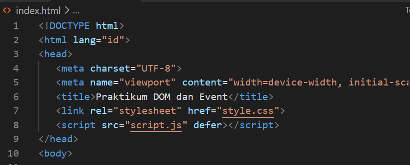
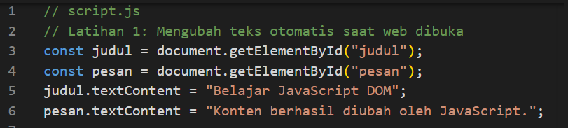

## 2. Event Click

Event Click digunakan untuk menjalankan perintah ketika tombol diklik oleh pengguna.

Pada latihan ini, tombol digunakan untuk menampilkan waktu ketika tombol ditekan.

Fungsi yang digunakan:

- `addEventListener()` = untuk mendeteksi tindakan pengguna.
- `click` = event yang dijalankan ketika tombol diklik.
- `new Date()` = untuk mengambil waktu saat ini.
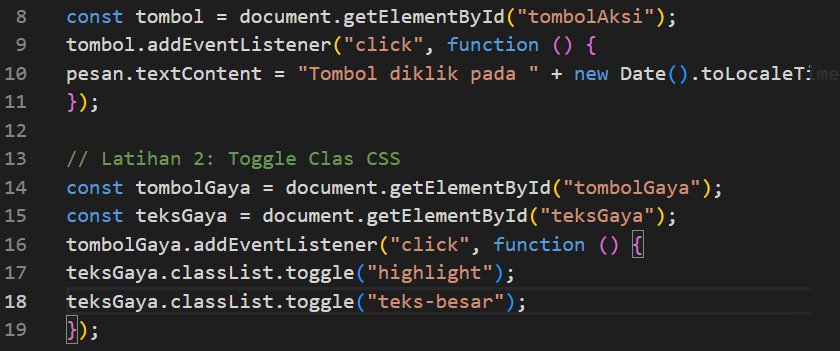
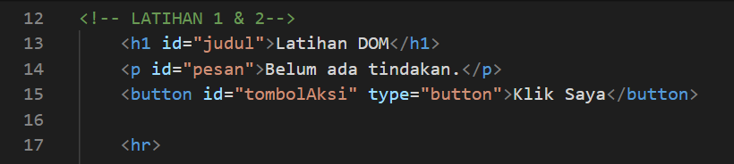
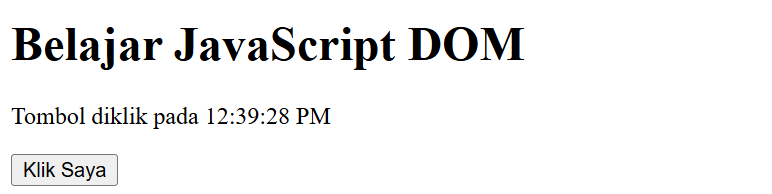

## 3. Mengubah Tampilan CSS

Latihan ini digunakan untuk mengubah tampilan halaman website menggunakan JavaScript.

Fungsi yang digunakan:
- `style` = untuk mengubah tampilan elemen secara langsung.
- `classList.add()` = untuk menambahkan class CSS.
- `classList.remove()` = untuk menghapus class CSS.
- `classList.toggle()` = untuk menambahkan atau menghapus class secara bergantian.
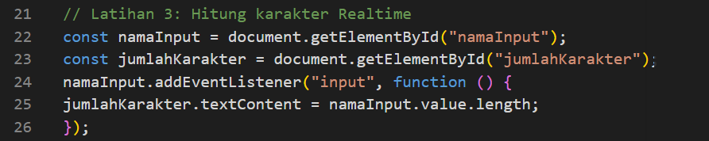
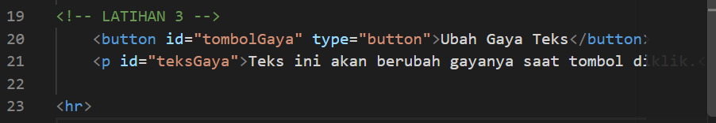
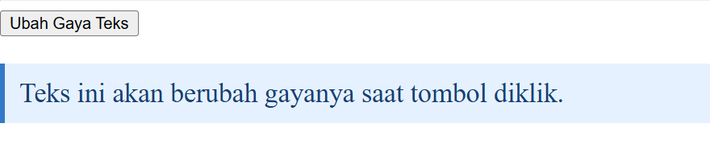

## 4. Event Input

Event Input digunakan untuk mendeteksi perubahan ketika pengguna mengetik sesuatu pada kolom input.

Pada latihan ini, JavaScript digunakan untuk menghitung jumlah karakter yang dimasukkan pengguna.

Fungsi yang digunakan:
- `addEventListener('input')` = untuk mendeteksi perubahan input.
- `value` = untuk mengambil nilai yang dimasukkan pengguna.
- `length` = untuk menghitung jumlah karakter.
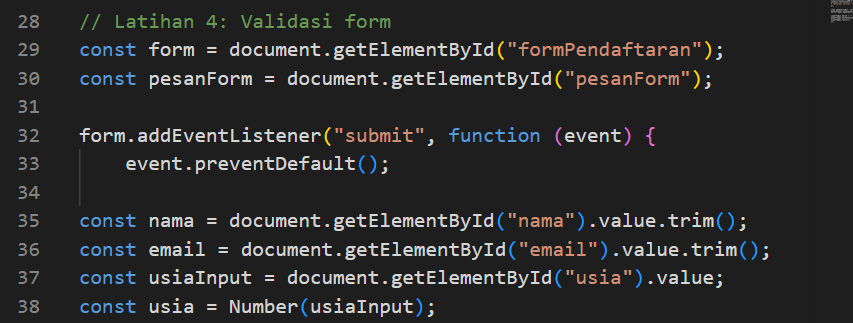
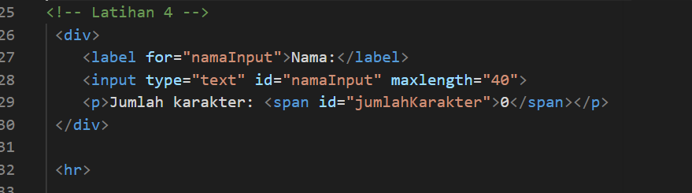
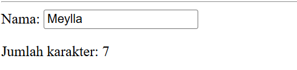

## 5. Validasi Form

Validasi form digunakan untuk memeriksa data yang dimasukkan pengguna sebelum formulir dikirim.

Pada latihan ini, data yang diperiksa meliputi nama, email, dan usia.

Fungsi yang digunakan:
- `submit` = event ketika formulir dikirim.
- `preventDefault()` = untuk mencegah halaman melakukan proses pengiriman secara langsung.
- `value` = untuk mengambil data dari input.
- `if else` = untuk memeriksa apakah data sudah sesuai atau belum.
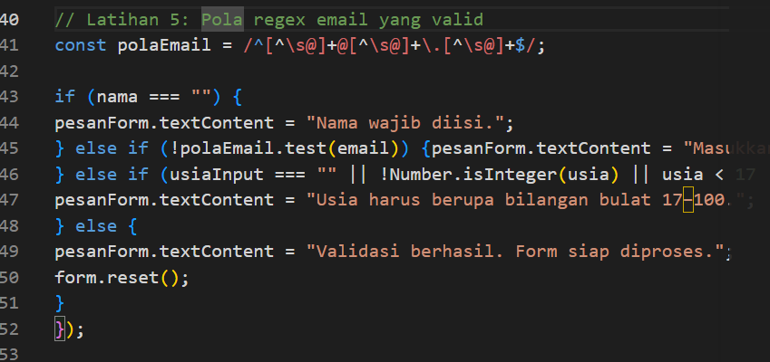
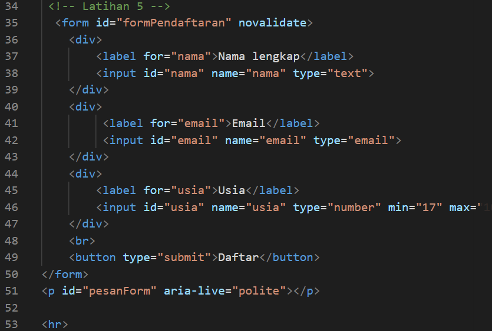
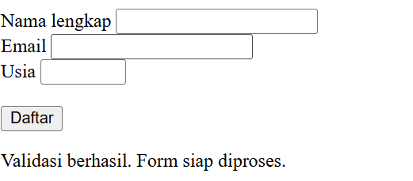

## 6. To-Do List

To-Do List merupakan latihan untuk membuat daftar tugas sederhana yang dapat ditambahkan oleh pengguna.

Pada latihan ini, pengguna dapat memasukkan tugas baru dan menampilkannya pada halaman website.

Fungsi yang digunakan:
- `createElement()` = untuk membuat elemen HTML baru.
- `appendChild()` = untuk menambahkan elemen ke dalam halaman.
- `textContent` = untuk memasukkan teks tugas.
- `value` = untuk mengambil tugas yang diketik pengguna.
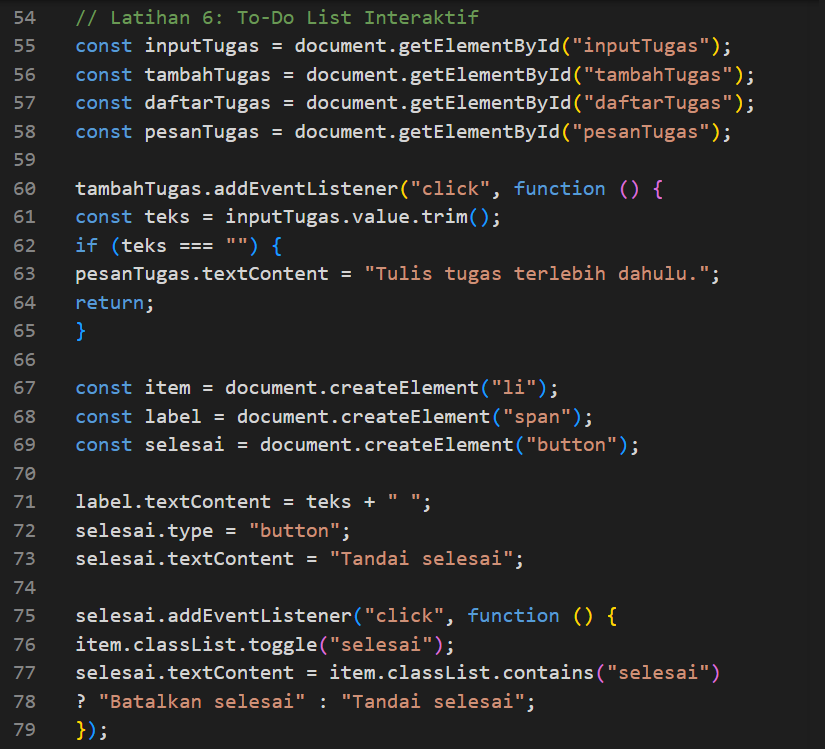
.png)
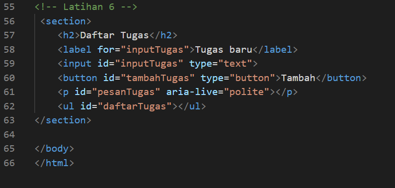
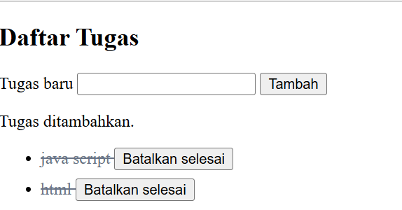

# 7. Form Pendaftaran

# Pendaftaran Workshop

## Deskripsi
Project ini merupakan halaman web pendaftaran workshop yang dibuat menggunakan HTML, CSS, dan JavaScript. Website ini memiliki tampilan modern, menarik, dan responsif sehingga dapat digunakan melalui komputer maupun perangkat mobile.

## Tujuan
Membuat halaman pendaftaran workshop dengan beberapa fitur interaktif menggunakan JavaScript dan addEventListener().

## Teknologi yang Digunakan
- HTML: Membuat struktur halaman website.
- CSS: Mengatur tampilan, warna, layout, dan desain responsif.
- JavaScript: Membuat fitur interaktif dan validasi formulir.

## Fitur Website
1. Validasi nama lengkap.
2. Validasi alamat email.
3. Pilihan sesi workshop.
4. Penghitung karakter nama secara langsung.
5. Ringkasan input secara otomatis.
6. Pesan error jika data tidak sesuai.
7. Pesan sukses jika pendaftaran berhasil.
8. Tombol reset untuk menghapus seluruh input.
9. Tampilan responsif untuk desktop dan mobile.

## Struktur Folder

pendaftaran-workshop/
│
├── index.html
├── style.css
├── script.js
└── README.md

## Cara Menjalankan Project
1. Buka folder project menggunakan Visual Studio Code.
2. Pastikan file index.html, style.css, dan script.js berada dalam satu folder.
3. Masukkan kode program ke masing-masing file.
4. Simpan semua file.
5. Buka file index.html menggunakan browser atau Live Server.
6. Isi formulir pendaftaran untuk mencoba fitur yang tersedia.

## Penerapan JavaScript
Project ini menggunakan beberapa event JavaScript, yaitu:

- addEventListener("input") untuk menghitung karakter dan menampilkan ringkasan input.
- addEventListener("change") untuk mendeteksi perubahan pilihan sesi.
- addEventListener("submit") untuk memproses dan memvalidasi formulir.
- addEventListener("reset") untuk mengembalikan formulir ke kondisi awal.
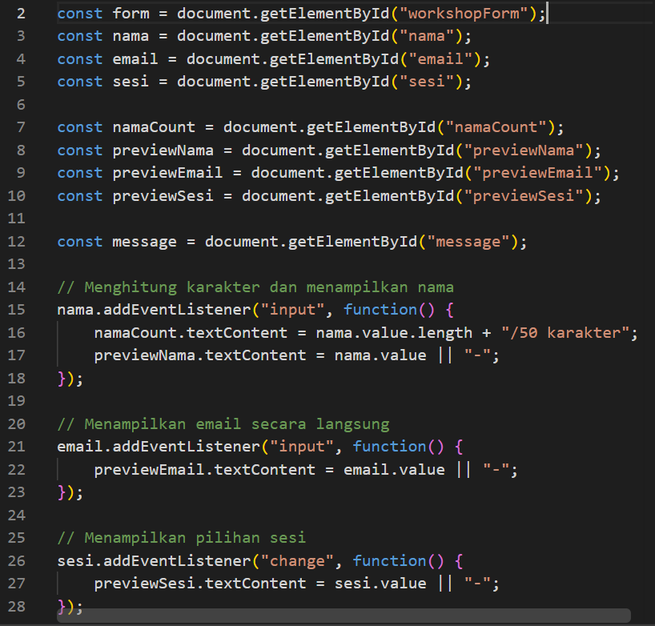
.png)
.png)
.png)
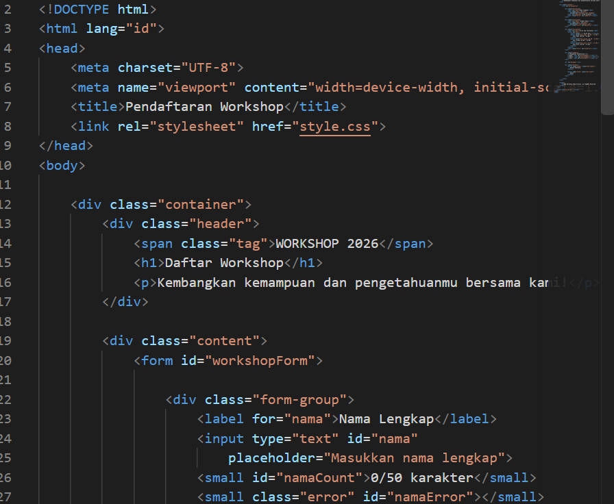
.png)
.png)
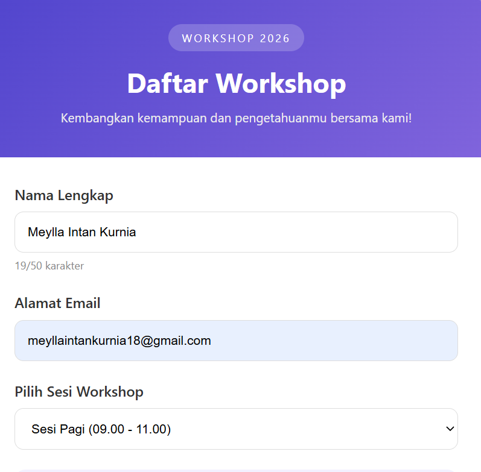
.png)

## Kesimpulan
Dari praktikum ini, saya dapat memahami cara kerja DOM dan Event Handling pada JavaScript. Saya juga mempelajari cara mengubah teks, mengatur tampilan CSS, menggunakan event click dan input, melakukan validasi form, serta membuat To-Do List sederhana.

Dengan mempelajari materi ini, saya dapat mengetahui bagaimana JavaScript membuat halaman website menjadi lebih interaktif dan dinamis.

Dengan adanya project ini, saya dapat memahami cara membuat formulir pendaftaran menggunakan HTML, CSS, dan JavaScript. Saya juga dapat mempelajari penggunaan addEventListener(), validasi input, serta cara membuat halaman website yang interaktif dan responsif.

---
Dibuat untuk memenuhi tugas praktikum Pemrograman Web.